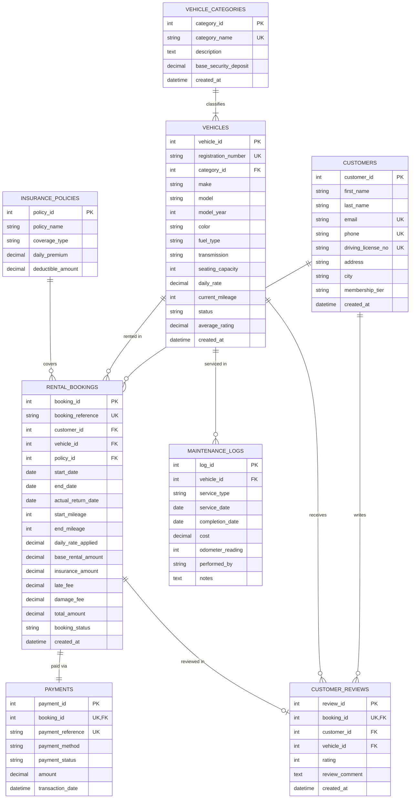

# Vehicle Rental Management System - SQL Architecture & Analytics

A comprehensive, production-grade relational database design, stored procedure automation, and analytical SQL project modeling an enterprise vehicle rental and fleet management platform (such as Hertz, Enterprise, or Zoomcar).

---

## 🏗️ Entity Relationship (ER) Diagram



---

## 📁 Project Structure

```text
vehicle-rental-sql/
├── 01_schema.sql                # Database definition, tables, foreign keys, and indexes
├── 02_seed_data.sql             # Realistic sample data (categories, vehicles, customers, bookings, logs)
├── 03_analytics_queries.sql     # 10 business and portfolio-grade analytical SQL queries
├── 04_views_and_procedures.sql  # Real-time operational views, checkout/return procedures & rating trigger
└── README.md                    # Project documentation & ER diagram
```

---

## 🚀 How to Run in MySQL

Open terminal and run the scripts in sequence:

```bash
# 1. Create database and tables
mysql -u root -p < 01_schema.sql

# 2. Populate realistic sample fleet data
mysql -u root -p < 02_seed_data.sql

# 3. Create views, stored procedures, and triggers
mysql -u root -p < 04_views_and_procedures.sql

# 4. Execute analytical queries
mysql -u root -p < 03_analytics_queries.sql
```

Alternatively, open and execute each script inside **MySQL Workbench**, **DBeaver**, or **DataGrip**.

---

## 💡 SQL Concepts Covered

1. **DDL & Constraints:** Primary Keys, Auto Increment, Foreign Keys with `ON DELETE CASCADE` / `ON DELETE RESTRICT`, `UNIQUE`, `CHECK` constraints (e.g., ratings between 1 and 5, dates check), and `ENUM` data types.
2. **Indexing:** B-Tree indexing on foreign keys, status flags, and frequently searched vehicle/booking columns.
3. **Joins:** Multi-table `INNER JOIN`, `LEFT JOIN`, and handling `NULL` values cleanly using `COALESCE`.
4. **Aggregations & Grouping:** `SUM`, `AVG`, `COUNT(DISTINCT ...)`, `GROUP BY`, and `HAVING` filters.
5. **Window Functions:** `DENSE_RANK()` for revenue ranking across vehicles and running cumulative totals (`SUM(...) OVER (ORDER BY ...)`).
6. **Common Table Expressions (CTEs):** Modular `WITH` clauses for multi-stage revenue and maintenance ROI calculations.
7. **Views:** Pre-computed operational reporting views (`v_active_rentals_dashboard`, `v_fleet_category_metrics`).
8. **Stored Procedures:** Business logic encapsulation for rental checkout (`sp_checkout_vehicle`) and return with late fee calculation (`sp_return_vehicle`).
9. **Triggers:** Automatic recalculation of vehicle average rating whenever a new review is inserted (`trg_after_review_update_rating`).
